# OLÁ, ME CHAMO CARLOS EDUARDO R B GONÇALVES 👋
Estudante de Engenharia de Software

Desde cedo, sou fascinado por tecnologia e pelo impacto que ela tem no mundo. Essa paixão me motivou a iniciar meus estudos de forma independente, ainda antes da faculdade, e hoje sigo aprofundando meus conhecimentos com foco em desenvolvimento de software (back-end).

## STACK

## ESTATÍSTICA

